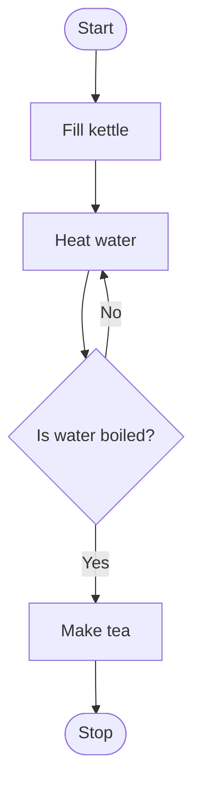
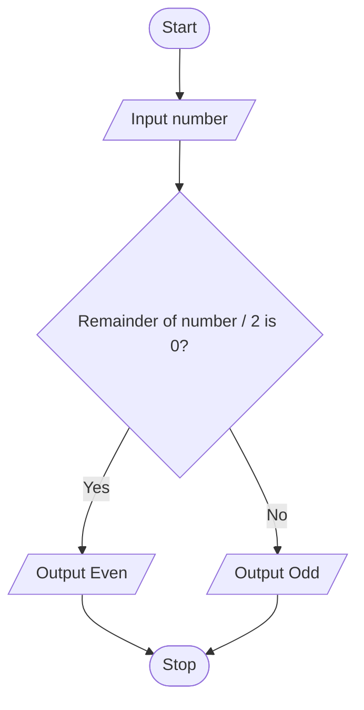

# Problem Solving: Algorithm, Pseudocode and Flowchart (Simple Notes)

Before writing code, we first plan how to solve the problem. There are three common ways to plan.

## 1. Algorithm
An algorithm is a list of steps, in plain English, that solves a problem. It is like a recipe.

**Example: making tea**
1. Boil water.
2. Put a tea bag in a cup.
3. Pour the hot water into the cup.
4. Wait 3 to 5 minutes.
5. Remove the tea bag.
6. Add sugar, milk or lemon if you like.
7. Stir and serve.

Any task can be broken into small steps like this.

## 2. Pseudocode
Pseudocode is like an algorithm, but it uses words that look like programming, such as `INPUT` and `OUTPUT`. It is not real code, so no computer runs it. It only helps you plan.

**Example: add two numbers**

Algorithm:
1. Take the first number.
2. Take the second number.
3. Add them.
4. Show the answer.

Pseudocode:
```
START
INPUT number1
INPUT number2
sum = number1 + number2
OUTPUT sum
END
```

## 3. Flowchart
A flowchart is a drawing of the steps, using boxes and arrows. When the answer can go two ways (yes or no), it uses a decision box.

**Example: making tea**



Flowcharts are best when a process has many choices, because you can see every path at a glance.

## Difference between the three

| | What it is | Looks like |
|---|-----------|------------|
| **Algorithm** | Steps in plain English | A numbered list |
| **Pseudocode** | English mixed with programming words | Code-like text |
| **Flowchart** | A picture of the steps | Boxes and arrows |

## Example: is a number even or odd?

**Algorithm:**
1. Take a number.
2. Divide it by 2 and look at the remainder.
3. If the remainder is 0, the number is even.
4. Otherwise, it is odd.

**Pseudocode:**
```
START
INPUT number
IF number % 2 == 0
    OUTPUT "Even"
ELSE
    OUTPUT "Odd"
END
```

**Flowchart:**



## Quick questions to test yourself
1. **When is a flowchart better than an algorithm?**
   When the process is complex and has many choices, because a picture is easier to follow.
2. **How does pseudocode help?**
   It is a middle step between the plain-English plan and real code, so turning it into Python or any other language becomes easier.

## Remember
- Algorithm = the plan in plain words.
- Pseudocode = the plan in code-like words.
- Flowchart = the plan as a picture.
- Plan first, then write code.
